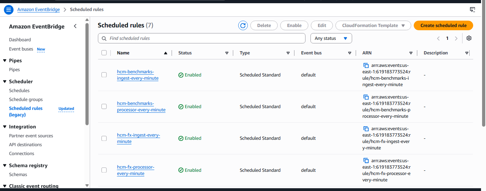
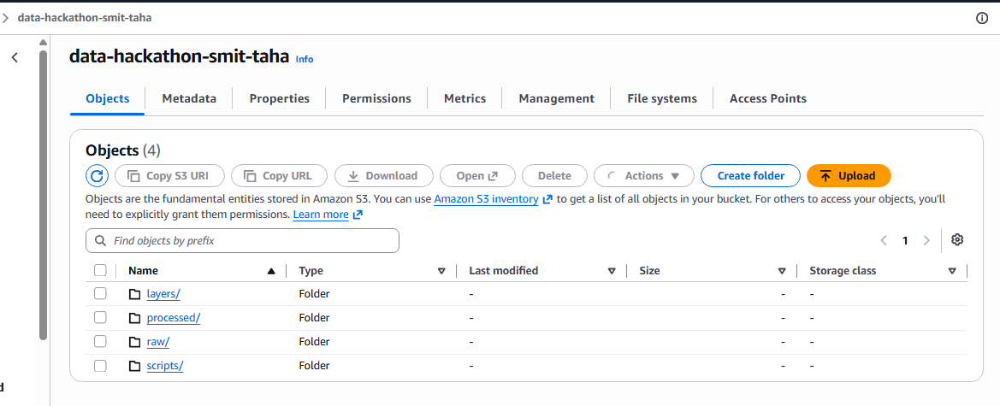
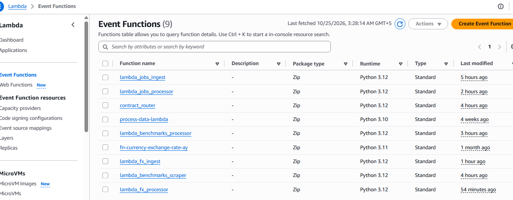
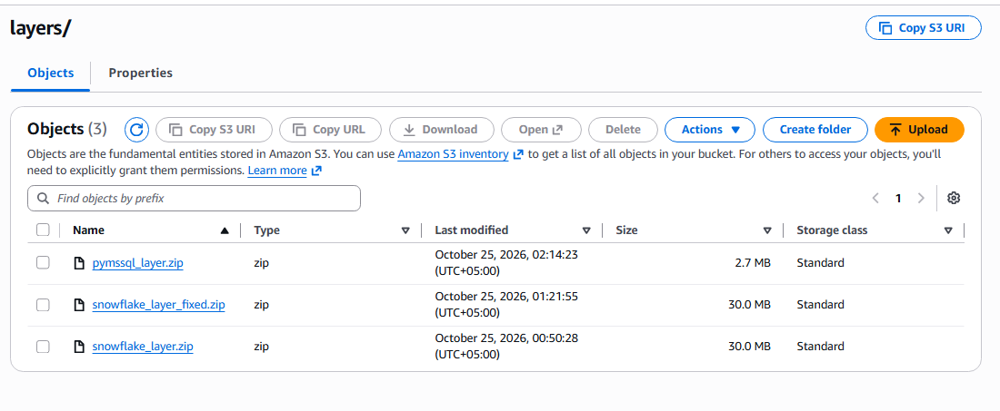
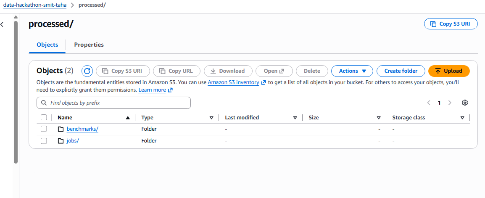
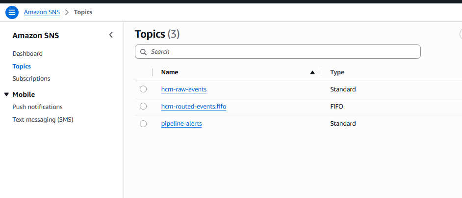
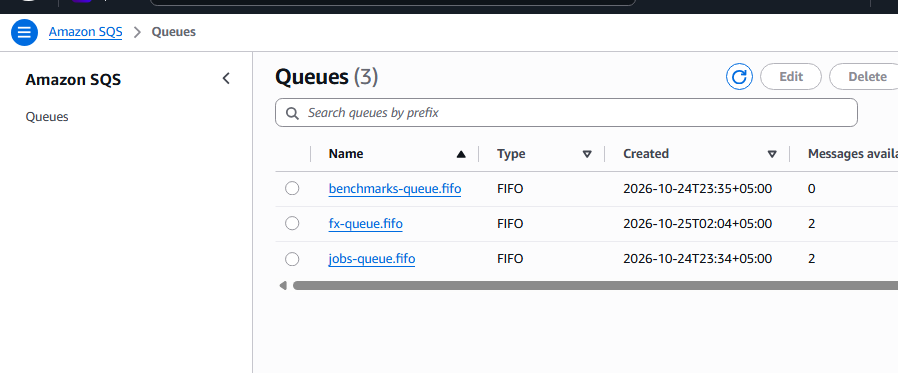
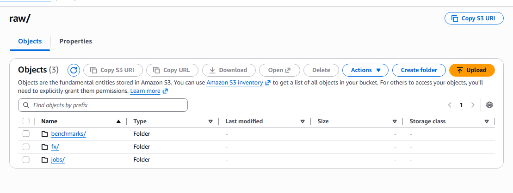

# 🚀 Polarapt HCM Real-Time Data Platform

### Event-Driven • Near Real-Time • Multi-Source HR Data Engineering Platform

**SMIT Cloud Data Engineering Hackathon — October 2026**

> A near-real-time data platform that ingests external HR data every minute, lands it in an Amazon S3 data lake, routes events through SNS/SQS FIFO, and processes each source independently into Snowflake, Amazon S3, and SQL Server.

---

## ⚡ Project at a Glance

| Metric | Implementation |
|---|---|
| 🌐 External Data Sources | **3** |
| ⚡ AWS Lambda Functions | **7** |
| ⏱️ EventBridge Rules | **6** |
| 📨 FIFO Queues | **3** |
| 🔄 Schedule | **Every 1 Minute** |
| 🎯 Target Systems | **Snowflake + S3 + SQL Server** |
| 🗃️ Raw Data Lake | **Amazon S3** |
| 🔐 Secret Management | **AWS Secrets Manager** |

### 🎯 Three Independent Data Pipelines

```text
🇺🇸 USAJOBS              → Snowflake
💼 BLS Salary Data       → S3 Processed Zone
💱 Open Exchange Rates   → SQL Server RDS
```

---

# 🏗️ Architecture

```text
                         ┌───────────────────────┐
                         │   Amazon EventBridge  │
                         │      Every Minute     │
                         └───────────┬───────────┘
                                     │
                ┌────────────────────┼────────────────────┐
                │                    │                    │
                ▼                    ▼                    ▼
        ┌──────────────┐     ┌──────────────┐     ┌──────────────┐
        │ Jobs Ingest  │     │ BLS Scraper  │     │  FX Ingest   │
        │    Lambda    │     │    Lambda    │     │    Lambda    │
        └──────┬───────┘     └──────┬───────┘     └──────┬───────┘
               │                    │                    │
               └────────────────────┼────────────────────┘
                                    ▼
                          ┌──────────────────┐
                          │  Amazon S3 RAW   │
                          │    Data Lake     │
                          └────────┬─────────┘
                                   │ ObjectCreated
                                   ▼
                          ┌──────────────────┐
                          │   Standard SNS   │
                          │  hcm-raw-events  │
                          └────────┬─────────┘
                                   ▼
                          ┌──────────────────┐
                          │ Contract Router  │
                          │      Lambda      │
                          └────────┬─────────┘
                                   ▼
                          ┌──────────────────┐
                          │     SNS FIFO     │
                          │  Routed Events   │
                          └────────┬─────────┘
                                   │
                      source-based filter policies
                                   │
             ┌─────────────────────┼─────────────────────┐
             │                     │                     │
             ▼                     ▼                     ▼
      jobs-queue.fifo     benchmarks-queue.fifo    fx-queue.fifo
             │                     │                     │
             ▼                     ▼                     ▼
      Jobs Processor       BLS Processor          FX Processor
             │                     │                     │
             ▼                     ▼                     ▼
        ❄️ Snowflake          📦 S3 Processed       🗄️ SQL Server
```

---

# 📸 Working Implementation

> The following screenshots were captured from the deployed hackathon environment.

### ⏱️ EventBridge — Six Every-Minute Schedules





### ⚡ AWS Lambda Functions



### 📦 S3 Raw Data Lake



### 🔄 Processed Data



### 📨 SNS Event Routing



### 📬 Source-Specific FIFO Queues



### 🧩 Lambda Layers / Supporting Files



---

# 🔥 Pipeline 1 — USAJOBS → Snowflake

```text
USAJOBS API
     ↓
lambda_jobs_ingest
     ↓
S3 raw/jobs/
     ↓
Standard SNS
     ↓
Contract Router
     ↓
SNS FIFO
     ↓
jobs-queue.fifo
     ↓
lambda_jobs_processor
     ↓
❄️ Snowflake
```

The ingestion Lambda retrieves job postings including:

- Job title
- Organization
- Department
- Location
- Salary range
- Opening date
- Closing date
- Job URL

Each raw response is stored in S3 with contract metadata.

The processor then transforms the records and loads them into Snowflake.

### ❄️ Snowflake Target

```text
Database  : POLARAPT_HCM
Schema    : RAW
Table     : JOBS
Warehouse : HCM_WH
```

### 🔁 Idempotent Loading

The Snowflake integration uses a **MERGE/upsert strategy**.

This means repeated minute-by-minute ingestion of the same job posting updates the existing record rather than creating unnecessary duplicates.

---

# 💼 Pipeline 2 — BLS Salary Benchmarks → Processed S3

```text
BLS Highest Paying Occupations
            ↓
lambda_benchmarks_scraper
            ↓
     S3 raw/benchmarks/
            ↓
   SNS → Router → FIFO
            ↓
 benchmarks-queue.fifo
            ↓
lambda_benchmarks_processor
            ↓
  📦 S3 processed/benchmarks/
```

The pipeline processes the **Top 10 Highest Paying Occupations** and produces structured records containing:

- Rank
- Occupation
- Median annual salary
- Estimated monthly salary
- Salary category

### 🛡️ BLS Resilience Strategy

During implementation, the official BLS page remained accessible through a browser, but automated cloud requests were rejected by Akamai protection with **HTTP 403**.

Instead of hiding this limitation, the pipeline implements a documented fallback:

```text
Attempt Live BLS Request
          ↓
   Successful?
      ↙       ↘
    YES        NO
     ↓          ↓
Live Data    Verified Snapshot
      \        /
       \      /
        ▼    ▼
       Same Pipeline
           ↓
      S3 → SNS → SQS
           ↓
      Processed S3
```

The fallback uses a verified snapshot of the BLS Top 10 dataset and keeps the downstream architecture operational.

---

# 💱 Pipeline 3 — Open Exchange Rates → SQL Server

```text
Open Exchange Rates API
          ↓
   lambda_fx_ingest
          ↓
      S3 raw/fx/
          ↓
  SNS → Router → FIFO
          ↓
     fx-queue.fifo
          ↓
 lambda_fx_processor
          ↓
 🗄️ Amazon RDS SQL Server
```

The pipeline retrieves USD-based rates for:

`PKR` • `SAR` • `AED` • `GBP` • `EUR` • `INR`

### 🗄️ SQL Server Target

```text
Amazon RDS SQL Server
          ↓
       HCM_DB
          ↓
    dbo.fx_rates
```

Each stored record contains:

- Currency code
- Exchange rate
- Base currency
- Source timestamp
- Raw S3 object key
- Processing timestamp

The processor deletes the SQS message **only after successful downstream processing**, allowing failed messages to remain available for retry.

---

# 📑 Metadata-Driven Data Contract

Every ingestion Lambda writes contract information with the raw object.

```json
{
  "timestamp": "UTC timestamp",
  "source": "jobs | benchmarks | fx",
  "record_count": 25,
  "response_status": 200
}
```

The `source` value is also stored in **S3 object metadata**.

The Contract Router reads this metadata and dynamically determines where the event should be routed.

---

# 📨 Why Standard SNS → Router → FIFO SNS?

The architecture deliberately separates raw S3 notifications from downstream processing.

```text
S3 ObjectCreated
      ↓
Standard SNS
      ↓
Contract Router Lambda
      ↓
SNS FIFO
      ↓
Message Attribute: source
      ↓
SNS Filter Policies
      ↓
Source-Specific FIFO Queue
```

This design provides:

- Loose coupling
- Source-aware routing
- Independent downstream processing
- Easier extension to future HCM data sources
- Better failure isolation

---

# 🔁 Why FIFO Queues?

Each source has its own FIFO queue:

```text
jobs-queue.fifo
benchmarks-queue.fifo
fx-queue.fifo
```

FIFO queues provide:

✅ Ordered processing within a source  
✅ Message grouping  
✅ Deduplication support  
✅ Independent buffering  
✅ Failure isolation  
✅ Decoupling between routing and processing

A problem in one data source therefore does not need to block the other pipelines.

---

# ⏱️ Near Real-Time Scheduling

Six EventBridge rules run every minute:

```text
hcm-jobs-ingest-every-minute
hcm-jobs-processor-every-minute

hcm-benchmarks-ingest-every-minute
hcm-benchmarks-processor-every-minute

hcm-fx-ingest-every-minute
hcm-fx-processor-every-minute
```

This provides continuous ingestion and processing across all three pipelines.

---

# ⚡ Lambda Microservices

Seven Lambda functions divide the platform into small, independent responsibilities:

| Function | Responsibility |
|---|---|
| `lambda_jobs_ingest` | Fetch USAJOBS data |
| `lambda_benchmarks_scraper` | Retrieve BLS salary benchmarks |
| `lambda_fx_ingest` | Retrieve currency exchange rates |
| `contract_router` | Metadata-driven event routing |
| `lambda_jobs_processor` | Transform jobs and load Snowflake |
| `lambda_benchmarks_processor` | Transform salary benchmarks |
| `lambda_fx_processor` | Load FX rates into SQL Server |

---

# 📦 S3 Data Lake Design

```text
data-hackathon-smit-taha/
│
├── raw/
│   ├── jobs/
│   │   └── YYYY/MM/DD/
│   │
│   ├── benchmarks/
│   │   └── YYYY/MM/DD/
│   │
│   └── fx/
│       └── YYYY/MM/DD/
│
├── processed/
│   ├── jobs/
│   └── benchmarks/
│
├── scripts/
│   └── jobs_glue.py
│
└── layers/
```

Raw data is preserved so that events can be replayed or reprocessed if required.

---

# 🧩 AWS Glue — Implementation & Account Limitation

The required jobs architecture specified:

```text
jobs-queue.fifo
       ↓
   AWS Glue
       ↓
   Snowflake
```

A PySpark Glue ETL implementation was prepared:

```text
glue_jobs/jobs_glue.py
```

and uploaded to:

```text
s3://data-hackathon-smit-taha/scripts/jobs_glue.py
```

A dedicated Glue IAM role was also configured.

However, AWS rejected both Glue crawler and Glue job creation with an **account-level restriction**:

```text
AccessDeniedException:
Account is denied access.
```

The same behavior occurred while testing with elevated permissions, indicating an account/service-level restriction rather than a normal Lambda or Glue IAM policy issue.

An AWS Support case was opened for the restriction.

### Fallback Implementation

To keep the hackathon system operational end-to-end:

```text
jobs-queue.fifo
       ↓
lambda_jobs_processor
       ↓
   Snowflake
```

The Lambda fallback successfully performs the required transformation and Snowflake loading.

The PySpark Glue implementation remains in this repository to demonstrate the intended ETL design.

---

# 🛡️ Reliability & Fault Tolerance

The architecture includes multiple reliability mechanisms:

- **S3 durable raw storage** for replay/reprocessing
- **SNS decoupling** between object creation and routing
- **SQS FIFO buffering** between routing and processors
- **Source-specific queues** for failure isolation
- Messages deleted only after successful processing
- **Snowflake MERGE** for idempotent jobs loading
- Documented **BLS fallback strategy**
- CloudWatch execution logging
- Independent ingestion and processing schedules

---

# 🔐 Security

Sensitive credentials are **not hardcoded in the repository**.

The implementation uses:

- AWS Secrets Manager for Snowflake credentials
- IAM roles for AWS service access
- Lambda environment configuration
- `.gitignore` for local secrets and build artifacts

Excluded files include:

```text
.env
.env.*
*secret*.json
*credentials*.json
*.pem
*.key
package/
layer_build/
*.zip
*-response.json
```

> **Hackathon Note:** The environment was optimized for rapid implementation. A production deployment should use least-privilege IAM, private database networking, Secrets Manager for all credentials, DLQs, alarms, and restricted security groups.

---

# 🧰 Technology Stack

| Area | Technology |
|---|---|
| ☁️ Cloud | AWS |
| ⏱️ Scheduling | Amazon EventBridge |
| ⚡ Serverless Compute | AWS Lambda |
| 📦 Data Lake | Amazon S3 |
| 📨 Pub/Sub | Amazon SNS |
| 📬 Messaging | Amazon SQS FIFO |
| 🔄 ETL | Python |
| 🔥 Distributed ETL | AWS Glue / PySpark implementation |
| ❄️ Data Warehouse | Snowflake |
| 🗄️ Operational Database | Amazon RDS SQL Server |
| 🔐 Secrets | AWS Secrets Manager |
| 📊 Monitoring | Amazon CloudWatch |
| 🌐 APIs | USAJOBS, Open Exchange Rates |
| 🕷️ Web Extraction | Requests, BeautifulSoup |
| 💻 Deployment | AWS CLI |

---

# 📂 Repository Structure

```text
polarapt-hcm-real-time-data-platform/
│
├── jobs_ingest/
│   └── lambda_function.py
│
├── benchmarks_scraper/
│   └── lambda_function.py
│
├── fx_ingest/
│   └── lambda_function.py
│
├── contract_router/
│   └── lambda_function.py
│
├── jobs_processor/
│   └── lambda_function.py
│
├── benchmarks_processor/
│   └── lambda_function.py
│
├── fx_processor/
│   └── lambda_function.py
│
├── glue_jobs/
│   └── jobs_glue.py
│
├── screenshots/
│
├── *.json
├── .gitignore
└── README.md
```

---

# ✅ Hackathon Deliverables

| Requirement | Status |
|---|:---:|
| USAJOBS ingestion | ✅ |
| BLS benchmark ingestion | ✅ |
| Open Exchange Rates ingestion | ✅ |
| Every-minute scheduling | ✅ |
| S3 raw data lake | ✅ |
| Contract metadata | ✅ |
| Standard SNS raw events | ✅ |
| Contract Router | ✅ |
| SNS FIFO routing | ✅ |
| Source-based filtering | ✅ |
| Three FIFO queues | ✅ |
| Jobs processing | ✅ |
| Benchmarks processing | ✅ |
| FX processing | ✅ |
| Snowflake integration | ✅ |
| SQL Server integration | ✅ |
| S3 processed output | ✅ |
| Snowflake MERGE / idempotency | ✅ |
| CloudWatch logging | ✅ |
| Glue PySpark implementation | ✅ Prepared |
| Secure Snowflake secrets | ✅ |

---

# 🚧 Production Roadmap

With additional production time, I would add:

1. Dead-letter queues for failed events
2. CloudWatch alarms and centralized monitoring
3. Least-privilege IAM policies
4. Secrets Manager for all database credentials
5. Private RDS networking
6. Terraform-based infrastructure
7. CI/CD deployment pipeline
8. Automated schema validation
9. API retry with exponential backoff
10. Glue deployment after AWS account access is restored

---

# 🎯 Final Outcome

The project demonstrates an **end-to-end event-driven data engineering platform** where three independent external HR data feeds are continuously ingested, persisted in a raw data lake, routed through a metadata-driven messaging layer, and processed into different downstream systems.

```text
USAJOBS              ───────────────► Snowflake
BLS Salary Data      ───────────────► Processed S3
Open Exchange Rates  ───────────────► SQL Server
```

### Key Engineering Concepts Demonstrated

`Event-Driven Architecture` • `Serverless ETL` • `Data Lake` • `Pub/Sub` • `FIFO Messaging` • `Metadata-Driven Routing` • `Idempotency` • `Fault Isolation` • `Multi-Target Data Processing`

---

## 👤 Author

### Muhammad Taha Khan

**SMIT Cloud Data Engineering**  
**Data Engineering Hackathon — October 2026**

> Built as a practical demonstration of event-driven, cloud-native data engineering on AWS.
